#  wpsld

wpsld is a desktop editor for [RO-Crate](https://w3id.org/ro/crate/1.3)
metadata. It describes files and folders with schema.org-based Linked Data
and saves the result as `ro-crate-metadata.json`. It is a lightweight
desktop take on [Crate-O](https://github.com/Language-Research-Technology/crate-o)
and Describo.

- Forms are built from schema.org 30.0, the version RO-Crate 1.3 uses.
- Forms can be narrowed by RO-Crate MASP profiles (machine-actionable
  profiles). The core RO-Crate profile is bundled. Other profiles load from
  a URL, a file, the [MASP catalogue](https://language-research-technology.github.io/ro-crate-masp/)
  or [profiles.ro-crate.org](https://profiles.ro-crate.org/).
- Written in Java 25 with JavaFX 27.

It is a work in progress. See [PLAN.md](PLAN.md) for the plan and
[MASP.md](MASP.md) for how profiles are read and used.

## Help in the app

Choose **Help > wpsld Help** for offline help. F1 opens help for the
focused editor control (Command-? also works on macOS). The question-mark
button beside the profile chooser opens help about profiles; field help
buttons show definitions of individual properties. The help window follows
the selected style and colours.

The [help contents](ui/src/main/resources/no/s11/wpsld/ui/help/index.md)
and its linked Markdown topics can also be read on GitHub.

## Screenshots

An example crate with made-up data, in some of the styles under View >
Style and View > Colours. The entities are listed on the left, the selected
one's form is in the middle, and its preview on the right.

| | |
|-|-|
| 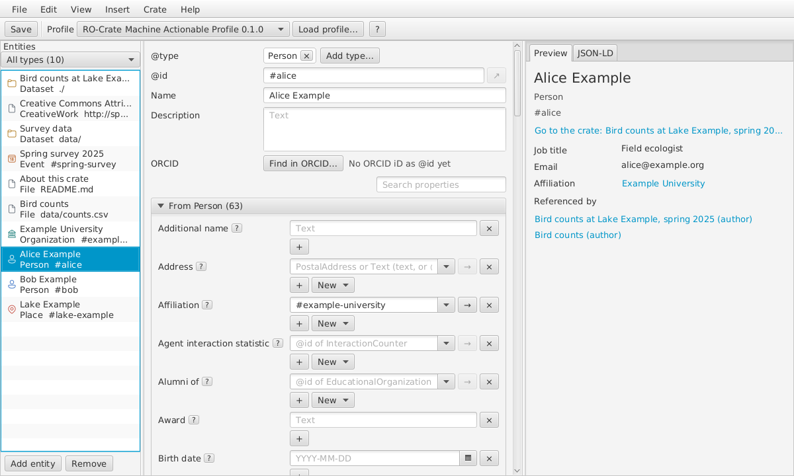 | 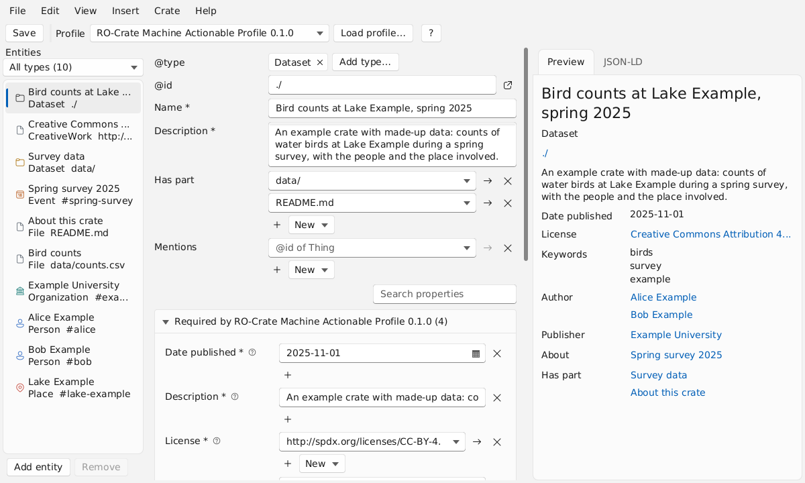 |
| A person, in the Classic style | The crate itself, with the fields its profile requires first, in the Windows 11 style |
| 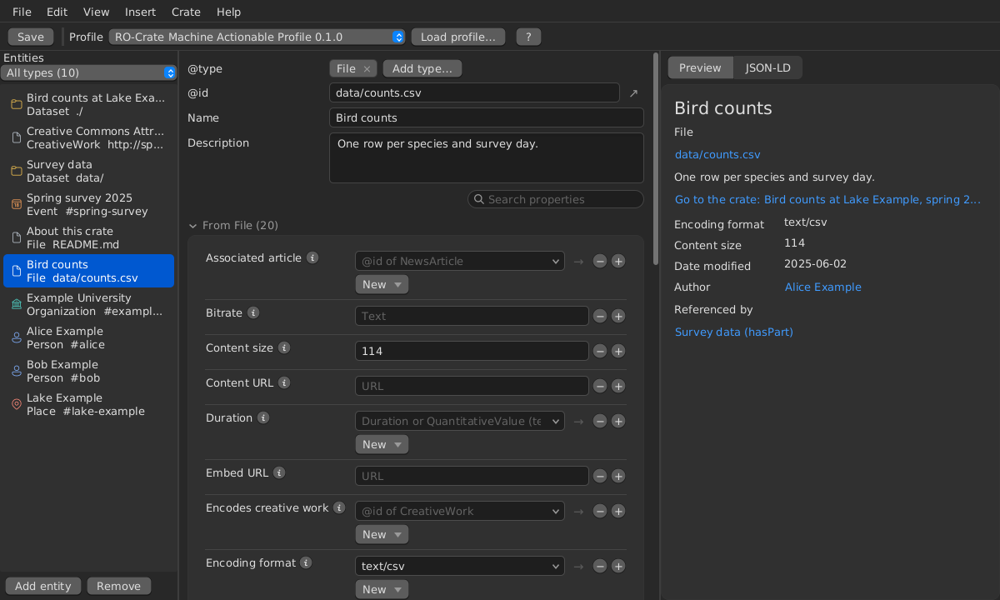 | 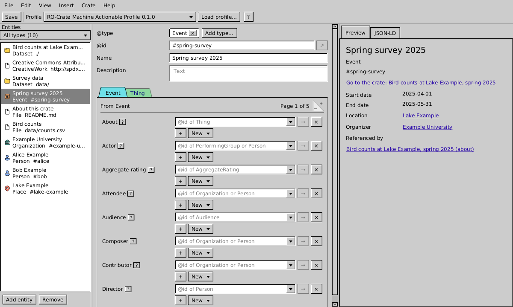 |
| A file, in the macOS style in dark colours, each value with − and + | An event, in the OS/2 Warp style, with the form as a notebook |
| 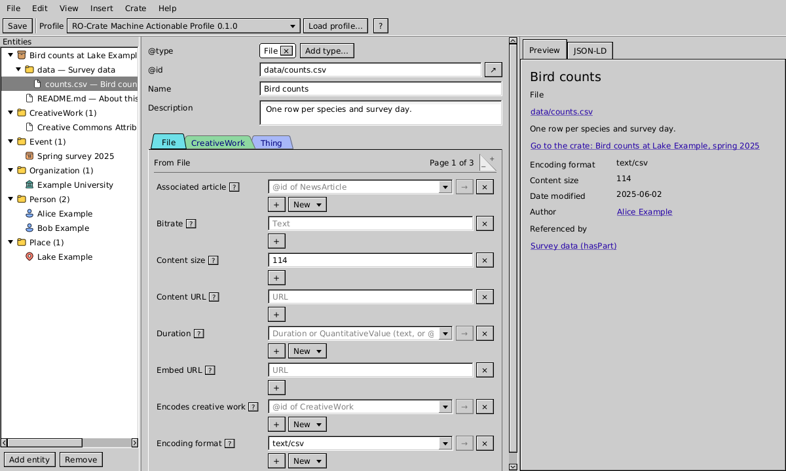 | |
| View > Entities by Folder: files by their paths, the other entities by type, in the OS/2 Warp style | |

### Making the screenshots again

The screenshots are made by a test,
[`ReadmeScreenshots`](ui/src/test/java/no/s11/wpsld/ui/ReadmeScreenshots.java),
which opens the made-up crate in
[`ui/src/test/resources/example-crate`](ui/src/test/resources/example-crate)
and takes one window per style. It only runs when the environment variable
`SCREENSHOTS` names the folder to write them to (an absolute path, as the
tests run in another folder), and is skipped otherwise. From the
repository's folder, with the same set-up as for building (see Building):

    SCREENSHOTS=$PWD/docs/screenshots ./gradlew :ui:test --tests '*ReadmeScreenshots' --rerun

`--rerun` makes Gradle run it even if nothing changed since the last test
run. The screenshots are taken headless, with JavaFX's own text rendering,
so their text looks plainer than on a desktop. To change what they show,
edit the example crate or the test, and check the new PNGs before
committing them.

## Running a release

Download a zip from the [releases](https://github.com/stain/wpsld/releases).
The zips for a platform include Java and JavaFX, so nothing else needs to
be installed.

| Zip | Platform | Start |
|-----|----------|-------|
| `wpsld-<version>-linux-x64.zip` | Linux x64 | `wpsld/bin/wpsld` |
| `wpsld-<version>-linux-aarch64.zip` | Linux arm64 | `wpsld/bin/wpsld` |
| `wpsld-<version>-osx-aarch64.zip` | macOS, Apple silicon | `wpsld.app` |
| `wpsld-<version>-osx-x64.zip` | macOS, Intel | `wpsld.app` |
| `wpsld-<version>-windows-x64.zip` | Windows x64 | `wpsld\wpsld.exe` |
| `wpsld-<version>-portable.zip` | any, with your own Java 25 and JavaFX 27 | `bin/wpsld`, `bin\wpsld.bat` |

### On the command line: wpsld-cli

Each zip also has `wpsld-cli`, wpsld's checks, Repair Crate and HTML
preview for scripts and CI, without a window: `wpsld/bin/wpsld-cli` on
Linux, `wpsld\wpsld-cli.exe` on Windows, `wpsld.app/Contents/MacOS/wpsld-cli`
on macOS, and `bin/wpsld-cli` (`bin\wpsld-cli.bat`) in the portable zip,
which needs no JavaFX for it. `CRATE` is a crate's folder or its metadata
file:

    wpsld-cli check CRATE              # what wpsld checks before saving, by the crate's profiles
    wpsld-cli check --json CRATE       # as JSON, as rocrate-validator writes it
    wpsld-cli repair --dry-run CRATE   # what Crate > Repair Crate would do
    wpsld-cli repair CRATE             # do it, writing the crate back
    wpsld-cli preview CRATE            # ro-crate-preview.html beside the metadata
    wpsld-cli preview -o page.html CRATE
    wpsld-cli help check               # the options of each

`check` exits with 0 if the crate passes (warnings allowed, e.g. files in
its folder that it doesn't describe), 1 if it has problems, and 2 if it
can't be read. Run it from the source with `./gradlew :bin:run --args='check
CRATE'`.

### Experimental terminal viewer

`wpsld-tui-<version>-linux-x64.zip` (built by the Dockerfile, see below) is a
small image with only the terminal viewer and `wpsld-cli`, without JavaFX:
run `wpsld-tui-linux-x64/bin/wpsld-tui CRATE` in a terminal. From the
source, build a local image with `./gradlew :tui:jlink`, then run
`tui/build/image/bin/wpsld-tui CRATE` (on Windows,
`tui\build\image\bin\wpsld-tui.bat`). `CRATE` is a
crate folder or metadata file. Use the arrow keys and Enter to open an
entity or follow a reference; Escape goes back or quits. The entity list
shows the root first, then sorts by type and name. Type to filter by name
or ID, or press `/` to focus the search (needed for searches starting with
`s` or `t`); Enter opens the selected result and Tab returns to the list.
Press `t` in the list to choose a type or parent type from a searchable
tree; choosing All types clears the type filter. PageUp and PageDown browse
adjacent entities in the filtered main list, or adjacent
resolved references in the property from which the current entity was opened.
Navigation stops at either end. In a nested view, `v` opens the current entity
as a top-level view, clearing filters if needed. Press `e` to edit a text
value or choose existing referenced entities.
In the chooser, type to filter by name or ID, Tab to the list and Space
to select; Enter applies the selection. In the multiline text editor,
Enter inserts a newline and Tab moves to Apply or Cancel. Press `s` to save.
Available actions appear at the bottom, including in dialogs; save messages
are replaced by the actions on the next key press. Unsaved changes are marked
with `*` and quitting asks before discarding them.

The viewer shows abbreviated property values, with referenced entities
identified by their short ID, type and name. Reference choices follow the
schema.org range and its subclasses; an unknown range offers all entities.
Existing unresolved or out-of-range references are kept.
Only existing text values and reference properties can be edited; adding
entities and editing IDs, types or other value kinds are not supported.
Saving is refused if the crate had read errors or its metadata file has
changed on disk since opening.

| | |
|---|---|
| 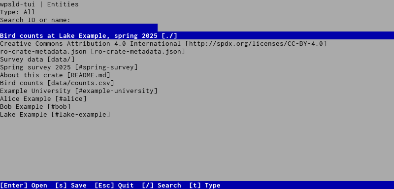 | 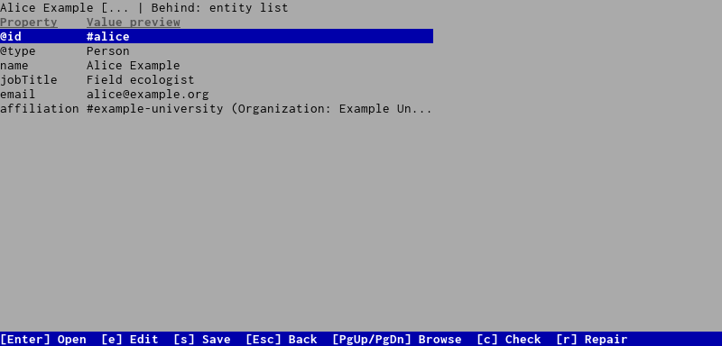 |
| The entities, root first | An author's properties; Enter opens a reference, `e` edits |
| 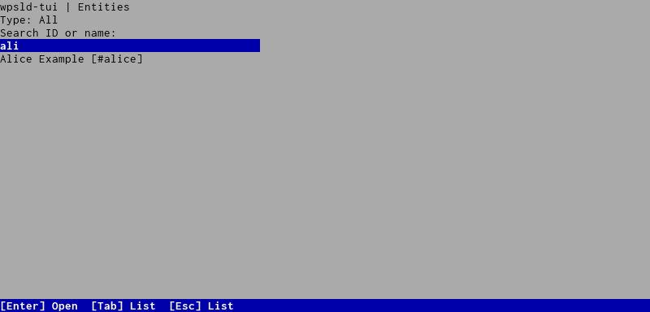 | 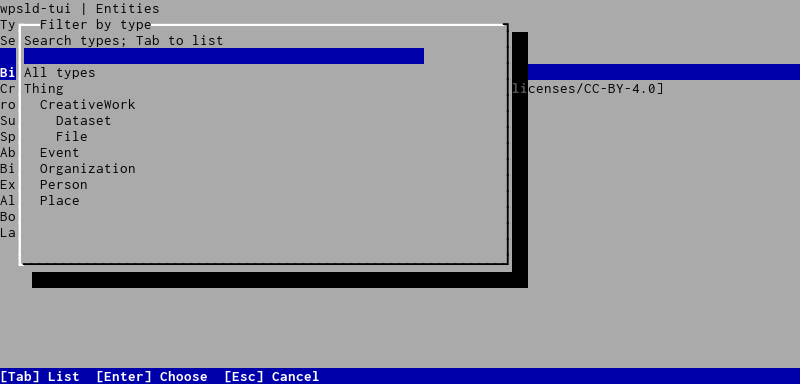 |
| Type to filter by name or ID; Tab goes to the list | `t` chooses a type from the tree of the crate's types |
| 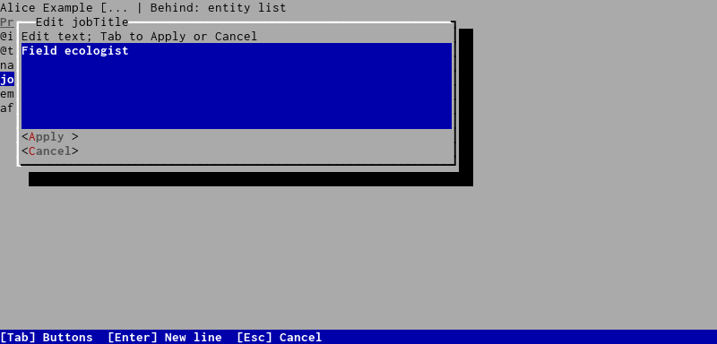 | 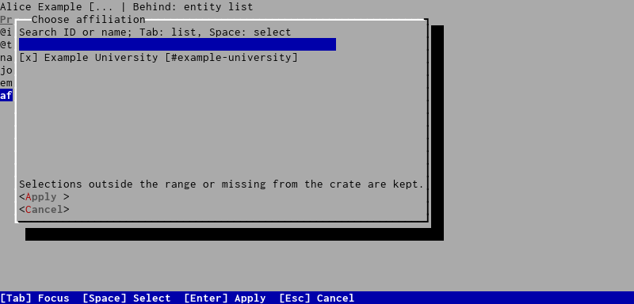 |
| `e` on a text value: Enter inserts a newline, Tab goes to Apply | `e` on a reference: type to filter, Space selects |
| 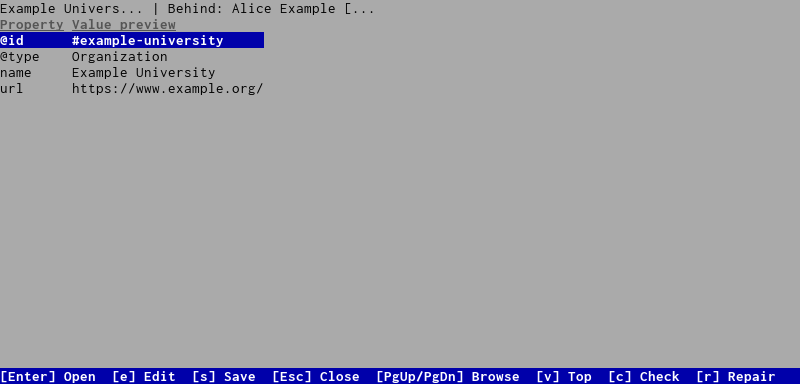 | |
| Enter on a reference opens it; Escape goes back | |

The image includes Java's desktop module, which Lanterna needs even in a
terminal. It is not included in the release zips of the editor, which don't
carry Lanterna.

Lanterna is LGPL-3.0-or-later. In the viewer's zip it is included unmodified,
as a module of its own (`com.googlecode.lanterna`) in the runtime image, and
not merged with the other libraries. To run the viewer with a modified or
newer Lanterna, put its jar in a folder and start the image's Java with
`--upgrade-module-path`, which replaces the module:

    wpsld-tui-linux-x64/bin/java --upgrade-module-path FOLDER \
        -m no.s11.wpsld.tui/no.s11.wpsld.tui.Main CRATE

The zip's `THIRD-PARTY-NOTICES.txt` says this too, with the licences.

The screenshots are made by
[`ReadmeScreenshots`](tui/src/test/java/no/s11/wpsld/tui/ReadmeScreenshots.java),
which runs the viewer on the example crate in a virtual terminal and draws it.
Like the editor's, it only runs with `SCREENSHOTS` set:

    SCREENSHOTS=$PWD/docs/screenshots ./gradlew :tui:test --tests '*ReadmeScreenshots' --rerun

### The apps are not signed yet

Windows and macOS mark files downloaded from the internet, and the mark
carries over to files unzipped from them. As wpsld is not signed, they then
refuse to start it the first time.

**Windows:** Microsoft Defender SmartScreen says it "prevented an
unrecognised app from starting". Either:

- before unzipping, right-click the zip, choose Properties, tick
  **Unblock** and press OK (or in PowerShell:
  `Unblock-File wpsld-<version>-windows-x64.zip`), or
- in the SmartScreen message, click **More info**, then **Run anyway**.

**macOS:** macOS says that "wpsld" can't be opened, or that Apple could not
check it for malicious software. Either:

- in Terminal, in the folder where you unzipped it:

      xattr -dr com.apple.quarantine wpsld.app

- or try to open it once, then go to System Settings > Privacy & Security,
  and click **Open Anyway** beside the message about wpsld.

The portable zip leaves out JavaFX. Either:

- run it with a JDK that includes JavaFX, such as BellSoft Liberica JDK
  "Full" or Azul Zulu "JDK FX", or
- copy the `lib/` files of the [JavaFX 27 SDK](https://gluonhq.com/products/javafx/)
  into its `lib/` folder.

### Where wpsld keeps its files

wpsld keeps profiles you have loaded, and its settings (Edit > Preferences,
and the style and colours from the View menu), in these places:

| | Profiles | Settings | Logs |
|-|----------|----------|------|
| Linux | `~/.local/share/wpsld/profiles/` | `~/.config/wpsld/settings.json` | `~/.local/state/wpsld/logs/` |
| macOS | `~/Library/Application Support/wpsld/profiles/` | `~/Library/Application Support/wpsld/settings.json` | `~/Library/Logs/wpsld/` |
| Windows | `%APPDATA%\wpsld\profiles\` | `%APPDATA%\wpsld\settings.json` | `%LOCALAPPDATA%\wpsld\Logs\` |

On Linux, `$XDG_DATA_HOME`, `$XDG_CONFIG_HOME` and `$XDG_STATE_HOME` are
used instead if set. You can remove kept profiles under Edit > Preferences
> Kept profiles, and set how much to log and clear the logs under Logs.

wpsld logs with Java's own logging (`java.util.logging`), as do the
libraries it uses: Tika's SLF4J through `slf4j-jdk14`, PDFBox's Commons
Logging by itself, and JavaFX and the JDK through `System.Logger`. It logs
to `wpsld.0.log`, starting anew at 20 MB and keeping three, and to the
console when started from one. A second wpsld running at the same time
logs to `wpsld.0.log.1` and so on. To log otherwise, give your own
configuration with `-Djava.util.logging.config.file=<file>`.

## Building

You need a JDK 25 or later. The Gradle wrapper downloads Gradle, and
JavaFX comes from Maven Central.

    ./gradlew build        # compile and run the tests
    ./gradlew :ui:run      # start the editor

The GUI tests run headless, with JavaFX's headless platform, so they need
no display. On Linux, JavaFX needs GTK 3 and the X11/GL libraries.

The tests run offline: those of the lookups (GeoNames, ORCID, ROR, DOIs)
answer from local test servers, and any other host name fails to resolve
(`OfflineResolverProvider`), so the build neither depends on web services
nor asks them on every run. A few tests check the services themselves, as
they answer today; they are in the JUnit category `Online` and left out of
`build`:

    ./gradlew onlineTest                         # ORCID, ROR, Crossref, DataCite, OpenStreetMap
    GEONAMES_USERNAME=<you> ./gradlew onlineTest # and GeoNames

Likewise, the tests that read thousands of damaged copies of files with
the readers of files' own metadata, which must neither hang nor run out of
memory (JUnit category `Damaged`):

    ./gradlew damagedTest                        # 20 rounds of each file
    ./gradlew damagedTest -PdamageRounds=200     # more

And the tests timing the editor on large crates, step by step, each step's
time in `ui/build/test-results/performance.tsv` (JUnit category
`Performance`, see PLAN.md, Performance on larger crates):

    ./gradlew performanceTest                         # fails when a step is over its limit
    ./gradlew performanceTest -PperformanceSlack=2    # twice the limits, on a slower machine
    ./gradlew performanceTest -PperformanceProfile    # and Flight Recordings, ui/build/performance/

### With conda

[`environment.yml`](environment.yml) gives OpenJDK 25 and the libraries
JavaFX needs on Linux:

    conda env create --prefix ./.conda_env -f environment.yml
    conda run -p ./.conda_env ./gradlew build

### Zips with Java and JavaFX included

These are built with `jlink`. JavaFX must be linked from its jmods, not
its jars, so that its native libraries end up in the image. Download the
[JavaFX 27 jmods](https://gluonhq.com/products/javafx/) for your platform.
Then, with an [Eclipse Temurin](https://adoptium.net/) 25 JDK:

    ./gradlew -Pplatform=linux-x64 -PjavafxJmods=/path/to/javafx-jmods-27.0.1 :ui:appImageZip

This makes `ui/build/image-zip/wpsld-<version>-linux-x64.zip`, an app image
with a native launcher from `jpackage`. `jpackage` can only build for the
platform it runs on. (conda-forge's OpenJDK 25 can't `jlink` yet; see
`environment.yml`.)

The [`Dockerfile`](Dockerfile) builds and tests with Temurin. It also
cross-links Linux and Windows x64 images with shell and `.bat` launchers,
and makes the terminal viewer's Linux zip, into `dist/`:

    podman build --network=host --output type=local,dest=dist .

The portable zip, without JavaFX, is `./gradlew :ui:distZip`, written to
`ui/build/distributions/`.

### Tests on GitHub

[`.github/workflows/test.yml`](.github/workflows/test.yml) builds wpsld and
runs its tests, the headless GUI tests too, for every pull request: they must
pass on Linux, and are reported for Windows and macOS. The release workflow
also runs them on each platform before making a release.
[`.github/workflows/integration-tests.yml`](.github/workflows/integration-tests.yml)
runs the online tests and the damaged-file tests (with 200 rounds), each as
a job of its own, once a month, when run by hand, and on each release
(reported, without holding the release up). GeoNames' test needs the
repository secret `GEONAMES_USERNAME`, and is skipped without it.

### Releases

[`.github/workflows/release.yml`](.github/workflows/release.yml) builds the
app image zips on each platform's GitHub runner, plus the portable zip.
The version is in [`gradle.properties`](gradle.properties): `<next>-SNAPSHOT`
between releases. `main` takes changes only through pull requests, so a
release's commits go on a branch, `release-<version>`.

To release, run the workflow on `main` from GitHub: Actions → Release → Run
workflow, with the version (e.g. `0.8.0`). It commits `version=0.8.0`, tags
it `v0.8.0`, commits `0.9.0-SNAPSHOT` and pushes the branch and tag. Then it
builds the tagged commit and makes a draft GitHub release, to check and
publish. Open the branch's pull request from the link in the run's summary
and merge it with *Create a merge commit*, before or after publishing:
squash or rebase would make new commits, and leave the tagged one out of
`main`'s history. The workflow doesn't open the pull request itself, as
letting workflows open pull requests (Settings → Actions → General) would
also let them approve them: leave that off.

The same from a checkout of an up-to-date `main`, with
[`scripts/release.sh`](scripts/release.sh):

```sh
scripts/release.sh 0.8.0        # on a branch release-0.8.0: version=0.8.0, tag v0.8.0, then 0.9.0-SNAPSHOT
git push --atomic origin release-0.8.0 v0.8.0
```

The pushed tag starts the workflow, which checks that `gradle.properties`
says the same version, builds it and makes the draft release. Don't make
the tag on GitHub's website: the tagged commit must have the version, as
Help > About shows. Run without a version, the workflow only keeps the zips
as artifacts.

[`codemeta.json`](codemeta.json) ([CodeMeta](https://codemeta.github.io/))
and [`.zenodo.json`](.zenodo.json) describe wpsld as software: authors,
licence, keywords. The release commit sets their version (and CodeMeta's
`dateModified`), and the workflow checks them against the tag too. Zenodo
archives each published GitHub release and registers a DOI for it, with
`.zenodo.json`'s metadata, once the repository is switched on in
[Zenodo's GitHub settings](https://zenodo.org/account/settings/github/).
Change other details (authors, description, funding) in both files.

## Project layout

| Module | Contents |
|--------|----------|
| [`lib`](lib) (`no.s11.wpsld`) | No JavaFX. The schema.org model, form fields, the RO-Crate model, reading and retrieving crates, JSON-LD contexts, MASP profiles and registries, and settings. The lookups of RO-Crate's recommended identifiers are in `no.s11.wpsld.lookup` (`GeoNames`, `ORCID`, `ROR`, `DOI`, and the bundled `SPDXLicenses` and `PRONOMFormats`), which uses the crate model but not the other way round; and files' own metadata (`FileMetadata`, asking the `MetadataReader` services, each isolated with a time limit; the built-in readers needing only the JDK are in `EmbeddedMetadata`). No JavaFX nor AWT: its dependencies are Jackson, Apache Tika (core, for file formats), commonmark-java (Markdown in the HTML preview) and JMustache (the HTML preview's page, a Mustache template). |
| [`readers-image`](readers-image) (`no.s11.wpsld.readers.image`) | Images' and videos' own metadata (`ImageMetadata`: EXIF, IPTC, XMP, PNG text, GPS; HEIC, AVIF, GIF, raw formats; MP4 and QuickTime), a `MetadataReader` with [metadata-extractor](https://github.com/drewnoakes/metadata-extractor). |
| [`readers-pdf`](readers-pdf) (`no.s11.wpsld.readers.pdf`) | PDFs' own metadata (`PdfMetadata`: document information and XMP), a `MetadataReader` with [Apache PDFBox](https://pdfbox.apache.org/), which needs AWT. |
| [`bin`](bin) (`no.s11.wpsld.cli`) | `wpsld-cli`: the commands `check`, `repair` and `preview` (`Main`), with [picocli](https://picocli.info/), over `lib`'s `CrateCheck`, `CrateRepair` and `CratePreview`, which the editor uses too. No JavaFX. |
| [`ui`](ui) (`no.s11.wpsld.ui`) | The JavaFX editor: the crate window (`CrateEditor`), the entity form (`EntityEditor`), the preview, the type chooser, the preferences, the lookup dialogs (`PlaceFinder`, `PersonFinder`, `OrganizationFinder`, `WorkFinder`, `LicenseFinder`, `FormatFinder`), and its styles (`Theme`). Besides JavaFX, it uses [Ikonli](https://kordamp.org/ikonli/) for the Fluent icons of the Windows 11 style, [commonmark-java](https://github.com/commonmark/commonmark-java) for help and Markdown descriptions. It requires the metadata reader modules, so that jlink links them into the runtime image. |

## Licence

The source code in this repository is under the
[Apache License 2.0](LICENSE.txt).

Except the template and stylesheet of the RO-Crate previews wpsld writes
(`ro-crate-preview*.mustache` and `ro-crate-preview.css` in
[`lib/src/main/resources/no/s11/wpsld/form/`](lib/src/main/resources/no/s11/wpsld/form/),
which make each `ro-crate-preview.html`), which are dedicated to the public
domain under [CC0 1.0](https://creativecommons.org/publicdomain/zero/1.0/),
so that a crate's preview can be distributed with it under any terms.

The built application also includes third-party software: Jackson,
commonmark-java, JMustache, picocli, Ikonli, Microsoft's Fluent UI System Icons, Apache Tika,
Apache PDFBox and FontBox, metadata-extractor, Adobe XMPCore, Apache
Commons (IO, Logging, Secure XML) and SLF4J, plus a
Java runtime and JavaFX in the zips for a platform. Their licences and notices are in
[`ui/src/notices/THIRD-PARTY-NOTICES.txt`](ui/src/notices/THIRD-PARTY-NOTICES.txt),
which the build puts in every zip and which Help > About wpsld shows. That
file covers the built application, not the source in this repository.

OS/2 and Warp are trademarks of IBM, Windows and Segoe are trademarks of
Microsoft, and macOS is a trademark of Apple. wpsld is not affiliated with
any of them; its "OS/2 Warp", "Windows 11" and "macOS" styles only resemble
their looks.
