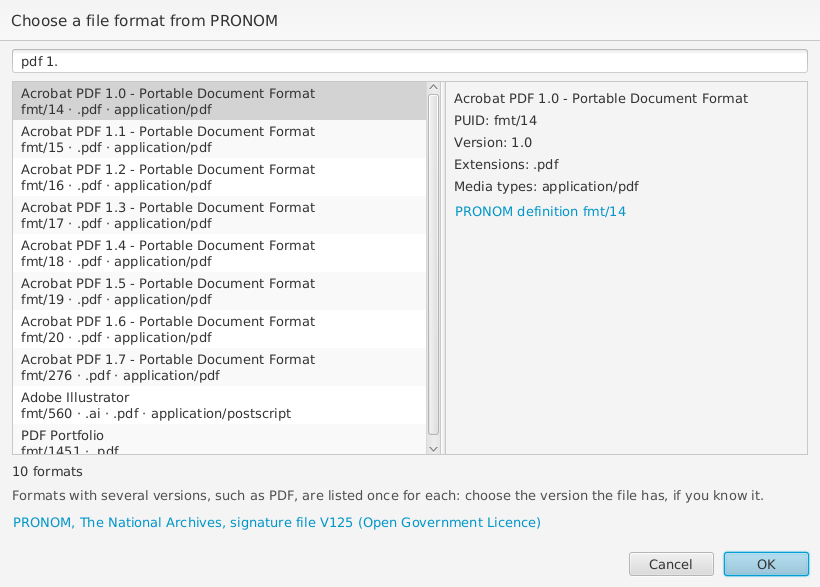

# File formats

A file's format, in its **Encoding format** (`encodingFormat`), is its
media type, such as `text/csv`, and, where it can be told, a link to the
format's description in PRONOM, the UK National Archives' registry of
file formats.

## Found from the file

When wpsld adds a file from the crate's folder (**Add to Has Part**,
**Insert > Files...**, or **Crate > Update File Details...**), it fills in
the file's `encodingFormat`, if it has none, with its media type, and a
link to its [PRONOM](https://www.nationalarchives.gov.uk/PRONOM/) format
where it can tell which. It looks at the file's content first, the
"magic" of its first bytes, using [Apache Tika](https://tika.apache.org/),
and then at its name. So a PDF named `scan.bin` is still a PDF.

Formats common in research data, and what wpsld writes for them:

- **Tables**: CSV `text/csv` (PRONOM x-fmt/18), tab-separated
  `text/tab-separated-values` (x-fmt/13), Parquet
  `application/vnd.apache.parquet`, Arrow and Feather
  `application/vnd.apache.arrow.file`, SQLite `application/x-sqlite3`
  (fmt/729); SPSS, Stata and SAS data files.
- **HDF5** `application/x-hdf5`, found by its signature also after a user
  block of 512, 1024, 2048... bytes, as some instruments write. NetCDF-4
  and MATLAB 7.3 `.mat` files are HDF5 inside, so they show as HDF5.
  HDF4 is `application/x-hdf`.
- **NetCDF-3** (classic, 64-bit offset and CDF-5) `application/x-netcdf`.
  NASA's **CDF**, which also uses `.cdf`, is `application/x-cdf`, told
  apart by its content.
- **Weather and climate**: GRIB `application/grib`, BUFR
  `application/bufr`.
- **Geography**: GeoJSON `application/geo+json` (fmt/1367), KML
  (fmt/244), shapefiles, LAS point clouds.
- **FITS** `application/fits` (x-fmt/383), **DICOM** `application/dicom`
  (fmt/574), MATLAB 5 `.mat` `application/x-matlab-data`.
- **Life sciences**: FASTA, FASTQ, SAM, VCF and PDB files are text,
  `text/plain`, as they have no media types of their own; BAM files are
  `application/gzip`.
- **Images, sound and video**: PNG `image/png`, TIFF `image/tiff`, JPEG
  2000 `image/jp2`, SVG, WAV, FLAC, MP4.
- **Documents**: PDF `application/pdf`, Markdown `text/markdown`
  (fmt/1149), Word `.docx` and other Office files by their names.
- **Code and notebooks**: Python `text/x-python`, R `text/x-rsrc`,
  Jupyter notebooks `application/x-ipynb+json`.
- **Structured text**: JSON `application/json`, JSON-LD
  `application/ld+json`, YAML `application/yaml`.
- **Archives**: ZIP `application/zip` (x-fmt/263), gzip
  `application/gzip` (x-fmt/266), tar, bzip2, xz, Zstandard, 7-Zip.

Some formats share an extension, and wpsld goes by the content: a
`.vcf` of variant calls isn't taken for a vCard, nor an electron
microscopy `.mrc` map for a MARC library record. Formats without a known
signature or media type, e.g. NumPy `.npy`, Avro, NIfTI or ROOT files,
are `application/octet-stream`.

PRONOM describes each version of a format apart, e.g. PDF 1.4, PDF/A-1b
and so on, and many formats share a media type. wpsld links a PRONOM
format only when exactly one has both the file's media type and its
extension: so PDF, PNG and TIFF files get their media type but no PRONOM
format. If you know the version, choose it from PRONOM (see [Choose a format from
PRONOM](#choose-a-format-from-pronom)).

A file whose content wpsld doesn't recognise, as many instruments' `.dat`
and `.bin` files are, gets `application/octet-stream` (any bytes), or
`text/plain` if it is text, rather than a guess from an extension that
many formats share. Describe what it is in its **Description**, and,
where the format has a specification on the web, link it in **Encoding
format** too.

## Choose a format from PRONOM

wpsld includes [PRONOM](https://pronom.nationalarchives.gov.uk/)'s list of
formats, so this works offline.

On a file, choose **New** beside **Encoding format**, then **Format from
PRONOM...**. The search starts with the file's media type, or the
extension of its name (for example `.csv`); you can also type a name, a
version or a PRONOM identifier (PUID) such as `fmt/19`. Choose the format
and **OK**: wpsld links the format, described as a WebPage and Standard
with its PRONOM address as `@id`, and adds its media type if the file has
none.

Many formats have several versions, and PRONOM lists each: PDF 1.4, 1.5,
1.7 and PDF/A all have the media type `application/pdf` and the extension
`.pdf`. Choose the version the file has, if you know it, or leave just the
media type.

**Crate > Repair Crate** links the PRONOM format where a file's media type
belongs to only one format, such as `text/csv` or `text/markdown`, but not
`application/pdf`. It also turns PRONOM addresses copied from its web site,
such as `https://pronom.nationalarchives.gov.uk/fmt/19`, into the form
RO-Crate uses, `https://www.nationalarchives.gov.uk/PRONOM/fmt/19`.
