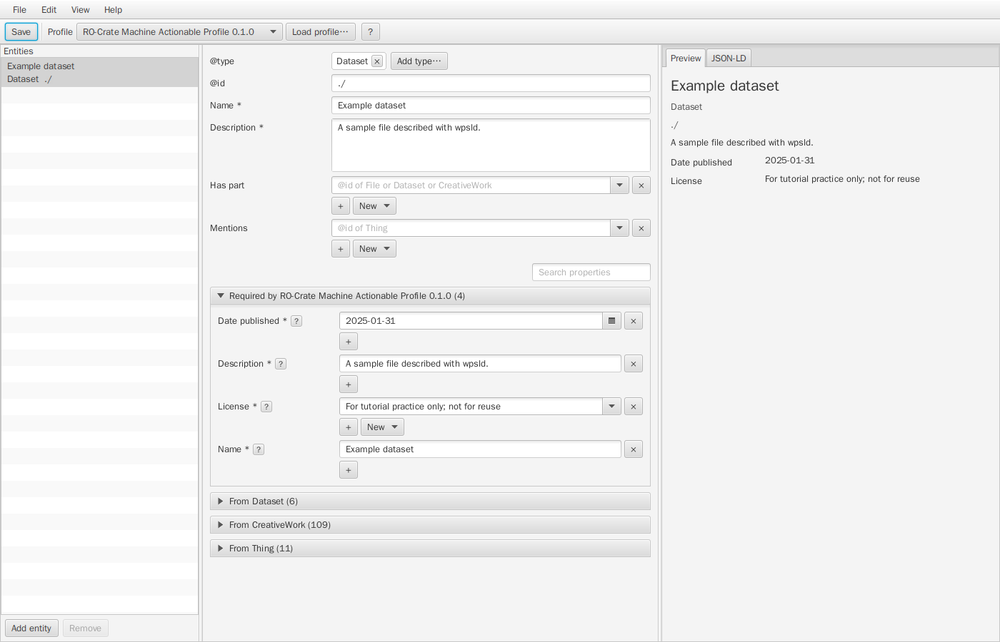
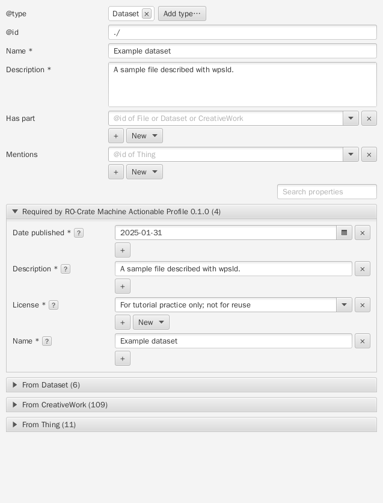
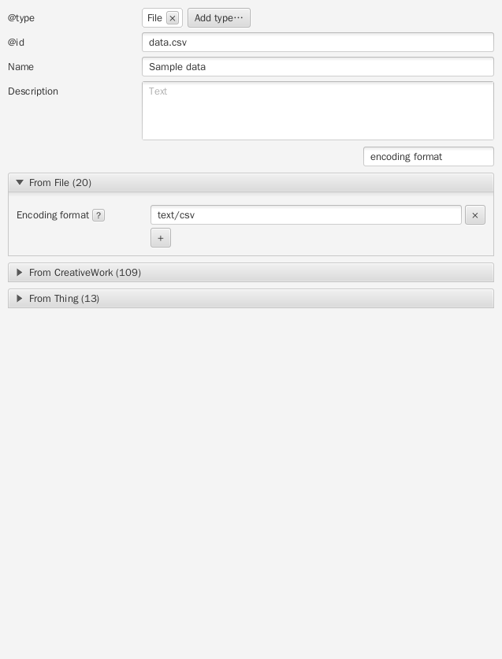
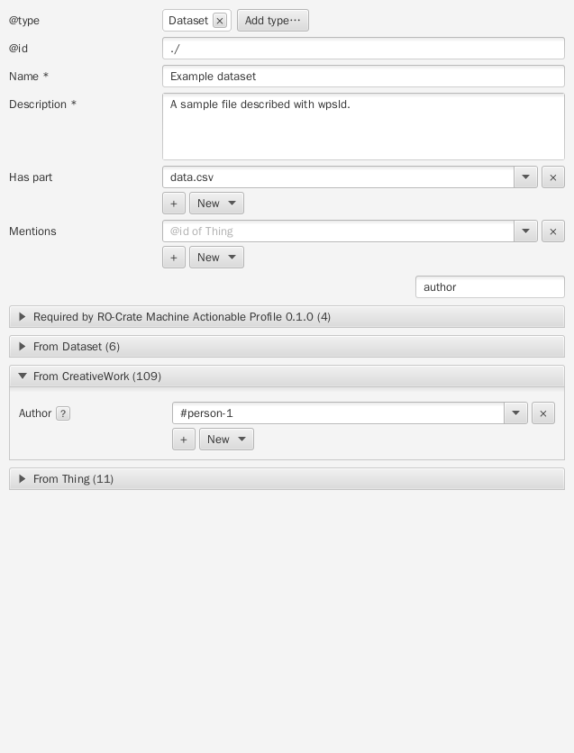
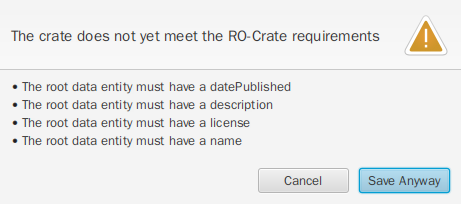
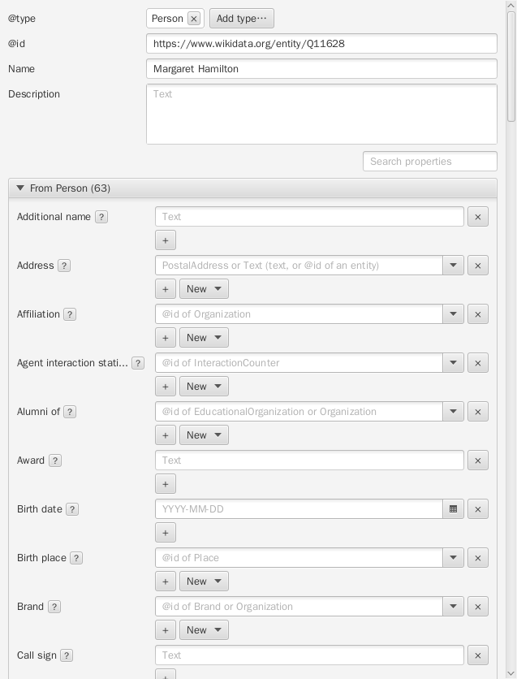
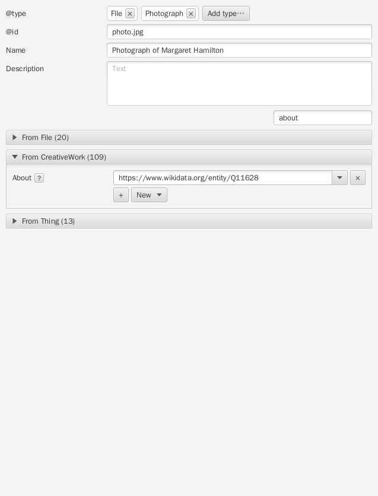

# Getting started

This walkthrough describes a small dataset and a file using wpsld. You do
not need to write JSON or know JSON-LD or schema.org. Allow about 15 minutes.
You can leave this help window open while working in the editor.

An RO-Crate brings together a description of a dataset, its files and
related information such as people and licences. wpsld saves that
description in a file named `ro-crate-metadata.json`.

## 1. Prepare a folder

Choose a folder containing a file you can describe. For practice, make a
new folder and put a sample file named `data.csv` in it using your usual
file manager. Do not use sensitive data for a shared example.

wpsld edits descriptions: it does not copy files into the folder, scan the
folder for you, make a ZIP, or deposit the crate in a repository.

## 2. Start a crate

Choose **File > New RO-Crate**. The first item on the left represents the
dataset as a whole; select it if it is not already selected. Its `@id` is
`./`, meaning the folder where you will save the metadata file. Leave that
identifier as it is for this example.

The list on the left contains the things being described, called entities.
The middle shows the selected item's form; the right shows a preview. The
default profile places required fields first and marks them with `*`.

## 3. Describe the dataset

In the middle form, enter a **Name** and **Description** for the whole
dataset. For practice these could be "Example dataset" and "A sample file
described with wpsld."

Find **Date published** and enter a date as `YYYY-MM-DD` or choose it from
the calendar. For the exercise you can use `2025-01-31`. For real research,
use the actual publication date rather than guessing it.

Enter the terms for reuse in **License**. For this exercise, you can enter
the text "For tutorial practice only; not for reuse". For real data, use a
licence or terms that actually apply to the whole dataset; ask your data
manager if you are unsure. Do not assume a licence applies to third-party
material. You can also describe a licence as a separate linked entity.

## 4. Describe and link a file

Under the dataset's **Has part**, choose **New > File**. This creates a
description linked to the dataset; it does not create or copy the file.

Select the new File in the list on the left. Change its `@id` from the
generated identifier to `data.csv` and press Enter. This is the path of the
existing file relative to the folder where the metadata will be saved.
For a file in a subfolder, use a path such as `data/results.csv`; use `/`
as the separator. Paths with spaces or other special characters need URI
encoding, for example `data%20files/results.csv` for a folder named
`data files`.

Give the file a **Name**, such as "Sample data". Optionally, find
**Encoding format** and enter `text/csv` if it is a CSV file. Select the
dataset again: **Has part** should now reference `data.csv`.

## 5. Add an author

With the dataset selected, find **Author**. Use **Search properties** if
shown, or open the relevant field group or notebook page. Choose **New >
Person** beside Author; this creates a person and links them to the dataset.
Select the new Person in the left list and enter their **Name**.

The generated `@id` identifies this person within the crate. If you have
their real ORCID, you may replace it with their ORCID URL and press Enter;
do not invent identifiers. Return to the dataset to see the Author link.
Use `+` to add another value where the field permits it.

## 6. Save and review

Choose **File > Save**. If wpsld reports missing requirements, read the
list and choose **Cancel** to return to the form and correct them. **Save
Anyway** saves an incomplete description; it does not make it valid.

In the save dialog, select your prepared folder and use the proposed name
`ro-crate-metadata.json`. The metadata file should now sit beside
`data.csv`. Check that the file you described really exists there and that
the names, links, date and licence are accurate. You can reopen the
metadata with **File > Open**.

The save-time checks are helpful but are not a complete validation or a
guarantee that the data can be shared. Before publishing, check the crate
with an RO-Crate validator and follow your repository's requirements.

## 7. Explore types and properties: a photograph

The forms use schema.org, a shared vocabulary of types and properties.
To explore it, try describing a photograph as well as the CSV. This
exercise only creates metadata; it does not download a photograph.

1. Select the dataset. Under **Has part**, choose **New > File**.
   Select the new File in the entity list. Change its `@id` to `photo.jpg`
   and press Enter; enter "Photograph of Margaret Hamilton" as its Name.
2. Select **Add type...**, search for `Photograph`, select it and choose
   **OK**. The photograph has both **File** and **Photograph** types:
   File says it is a file in the crate; Photograph describes its content.
   Keep both types. Different types offer different properties.
3. Use **Search properties** to find **About**. Choose **New > Thing**
   in that field to create and link an entity. Select the new Thing in the
   entity list, choose **Add type...**, search for `Person`, and choose
   **OK**. Person replaces the more general Thing type.
4. Enter `Margaret Hamilton` as the person's **Name**, and set their `@id`
   to `https://www.wikidata.org/entity/Q11628`; press Enter. This identifies
   the software engineer Margaret Hamilton in Wikidata. wpsld does not
   retrieve her name automatically; you enter it in the form.
5. Select the photograph again and find **About**. It should now reference
   the Wikidata identifier. The question-mark or info button beside a
   property shows its definition; explore other properties using search.

For a real crate, only describe a photograph you actually have and verify
that it depicts the person identified. Put the real `photo.jpg` in the
crate folder, or use its correct relative path as the File's `@id`, and
check rights before sharing it. Do not claim a CSV is a photograph or invent
a person or their identifier. If you have no such photograph, remove this
practice File and Person before sharing, then save again.

## Further reading

This exercise follows the ideas in the [RO-Crate 1.3 introduction](https://www.researchobject.org/ro-crate/specification/1.3/introduction)
and the [Galaxy RO-Crate introduction](https://training.galaxyproject.org/topics/fair/tutorials/ro-crate-intro/tutorial.html).
The Galaxy tutorial uses an older RO-Crate version and edits JSON by hand;
wpsld creates new metadata for RO-Crate 1.3 using forms.
