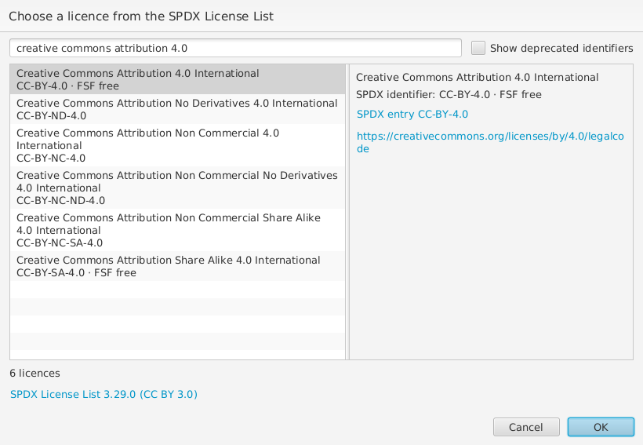

# Licences

RO-Crate asks for a **License** on the crate itself (the root dataset), and
on any file whose licence differs from the crate's. wpsld includes the
[SPDX License List](https://spdx.org/licenses/), which names the common
licences and gives each a short identifier, such as `CC-BY-4.0` or
`Apache-2.0`.

To add one, choose **New** beside **License**, then **Licence from
SPDX...**. Type part of the licence's identifier or name, for example
`cc-by-4.0`, `apache` or `creative commons attribution 4.0`: the list
narrows while you type, with whether a licence is OSI approved or FSF free.
The licence selected is described beside the list, with links to its
SPDX entry and to the licence itself. Choose one and
**OK**.

wpsld then adds the licence as RO-Crate recommends: a CreativeWork whose
`@id` is its SPDX address, such as `http://spdx.org/licenses/CC-BY-4.0`,
named as SPDX names it, with its SPDX identifier (`CC-BY-4.0`) as a
PropertyValue in its **Identifier**. If the crate already has that licence,
for example to give a file the same licence as the crate, it is linked
rather than added again.

SPDX has replaced some identifiers, for example `GPL-2.0` by `GPL-2.0-only`
and `GPL-2.0-or-later`. Those are hidden unless you tick **Show deprecated
identifiers**, e.g. to match what a crate already says.

Crates made elsewhere may give a licence in other ways, for example as
the text `CC-BY-4.0`, with an address copied from the browser such as
`https://spdx.org/licenses/Apache-2.0.html`, or with the licence's own web
page, such as `https://creativecommons.org/licenses/by/4.0/`. **Crate >
Repair Crate** turns these into links to the SPDX licence, merges licences
that turn out to be the same, and adds the SPDX name and identifier where
they are missing, keeping any name the licence already has; a licence's
own web page is kept as its **URL**. Some pages can't tell which licence
is meant, such as GNU's GPL page, which serves both "GPL-3.0-only" and
"GPL-3.0-or-later": those are left for you to choose.

For a licence that isn't on the SPDX list, choose **New > CreativeWork**
instead, set its `@id` to the licence's own web address, and give it a
**Name** and a **Description** summarising it.
