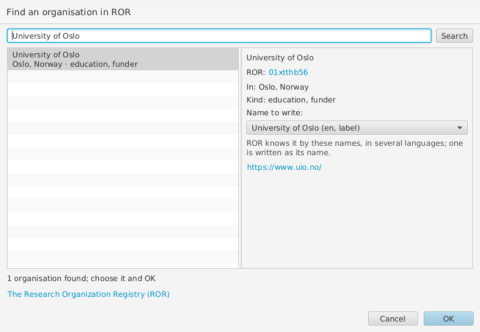
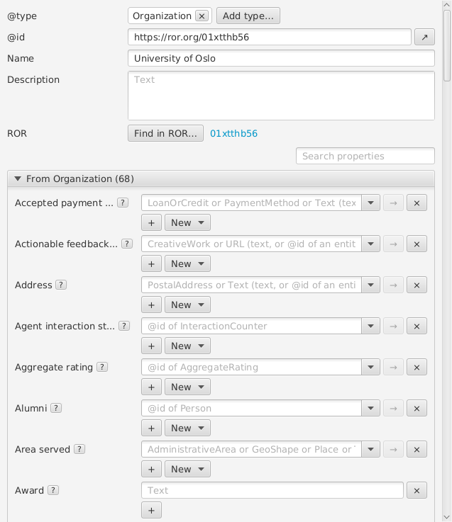

# Organisations

RO-Crate recommends identifying organisations, such as a publisher, funder
or a person's affiliation, by their [ROR](https://ror.org/) identifier,
such as `https://ror.org/01xtthb56`. To add one from ROR, choose **New**
beside **Publisher** (or **Funder**, **Affiliation** and other fields that
take an organisation), then **Organization from ROR...**. Type its name,
or its ROR identifier, and choose **Search**: the organisations found are
listed with where they are and what kind they are.

An organisation often has many names, in several languages: ROR's display
name, and others such as its name in the local language, former names and
acronyms. Only one is written, as its `name`; choose it under **Name to
write**, e.g. *Universitetet i Oslo* rather than *University of Oslo*.
Choose **OK**: wpsld adds it as an Organization with its ROR identifier as
`@id`, the name chosen, its web site as `url`, and its city as `location`,
a Place from GeoNames (see [Places](places.md)), shared with other
organisations in the same city. If the crate already has it, it is linked
instead.

An Organization's form shows its ROR identifier, if its `@id` is one,
beside **Find in ROR...**, which looks up an organisation you have already
added, by its name, and gives it its ROR identifier as `@id`.

Looking organisations up needs an internet connection, but no account;
ROR allows about 50 searches in 5 minutes. Without a connection, you can
still type the ROR identifier as the organisation's `@id`. **Crate > Repair
Crate** writes ROR identifiers given in other forms, such as
`http://ror.org/01xtthb56/`, as `https://ror.org/01xtthb56`, and merges
organisations that turn out to be the same; identifiers whose check digits
are wrong are left for you to correct.
