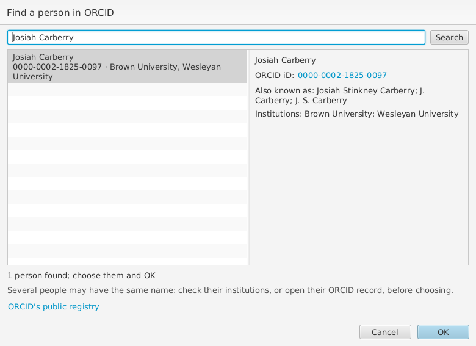
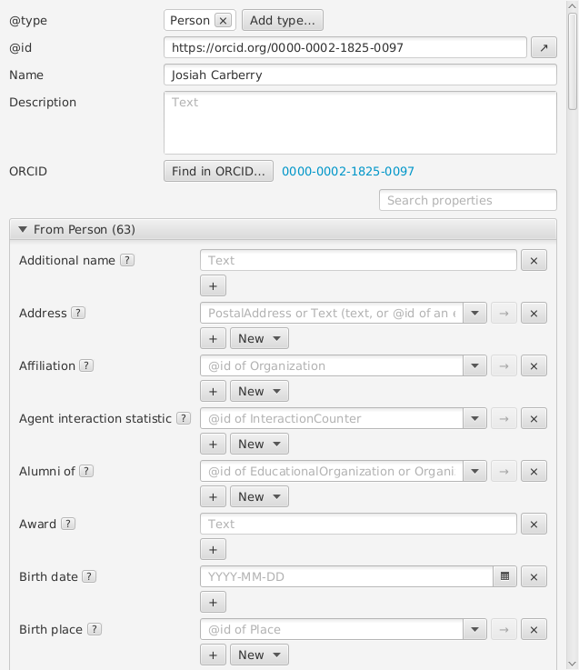

# People

RO-Crate recommends identifying people by their
[ORCID iD](https://orcid.org/), such as
`https://orcid.org/0000-0002-1825-0097`. To add an author (or another
person) from ORCID, choose **New** beside **Author**, then **Person from
ORCID...**. Type their name, or their ORCID iD, and choose **Search**: the
people found are listed with their ORCID iD and institutions, and the one
selected with their other names, its ORCID iD a link to their record. Several
people may have the same name, so check before choosing. Choose one and
**OK**: wpsld adds them as a Person with their ORCID iD as `@id`, their
name, and their given and family names. If the crate already has them,
they are linked instead.

A Person's form shows their ORCID iD, if their `@id` is one, beside **Find
in ORCID...**, which looks up a person you have already added, by their
name, and gives them their ORCID iD as `@id`.

Looking people up needs an internet connection, but no account. Without
one, or if ORCID can't be reached, you can still type the ORCID iD as the
person's `@id`. **Crate > Repair Crate** writes ORCID iDs given in other
forms, such as `http://orcid.org/0000-0002-1825-0097/`, as
`https://orcid.org/0000-0002-1825-0097`, and merges people who turn out to
be the same; iDs whose check digit is wrong are left for you to correct.
