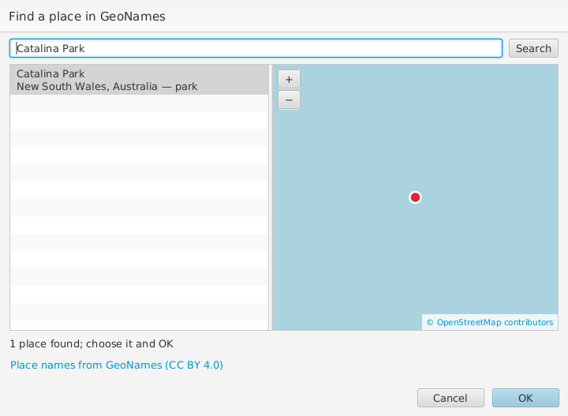
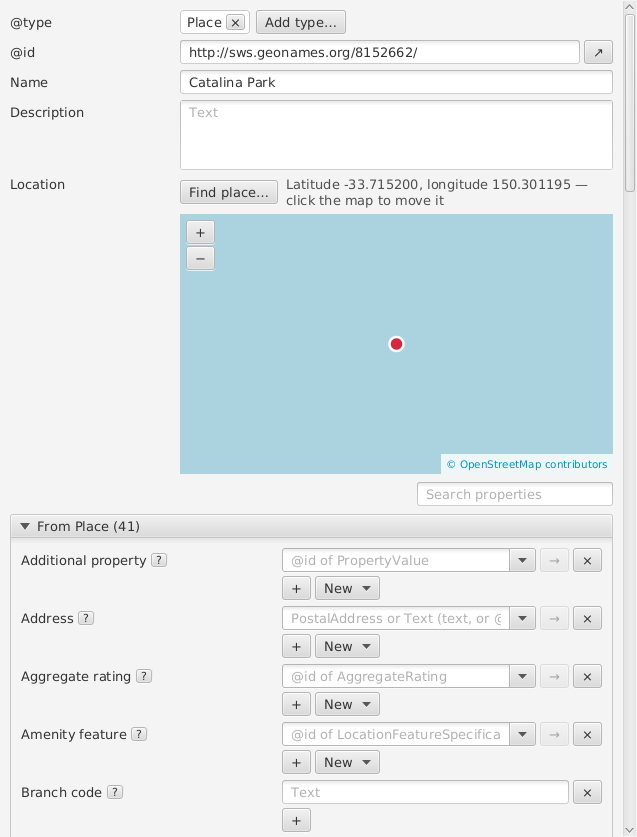

# Places

To say where something is, or which area it covers, link it to a
**Place** with **Content location** (where it was made or what it shows)
or **Spatial coverage** (the area it is about).

The easiest way is **New** beside the property, then **Place from
GeoNames...**. Type the name of the place and choose **Search**; the
matches are listed with their region, country and kind (park, city,
mountain...), and the one selected is shown on a map. Choose one and
**OK**: wpsld adds the place with its GeoNames identifier, which RO-Crate
recommends, its name and web page, and where GeoNames has it. If the crate
already has that place, it is linked instead of added again.

Looking places up needs a free GeoNames account: make one at
[geonames.org](https://www.geonames.org/login), enable its free web
services on your account page, and enter your username in **Edit >
Preferences > Places**.

A place's form shows it on a map under **Location**. Drag the map to move
it, and scroll or use **+** and **−** to zoom. Click the map to put the
place where you clicked, for example a more exact spot than GeoNames has,
or a place GeoNames doesn't know. **Find place...** looks up a place you
have already added, by its name. The map is from OpenStreetMap, so it
needs an internet connection.

Behind the scenes, the location is a **Geometry** linked from the place's
**Geo**, with the point as Well-Known Text in **As WKT**, for example
`POINT (150.301195 -33.7152)` (longitude first). You can edit that
directly, e.g. for a line or an area. Places in older crates with
GeoCoordinates, Latitude and Longitude are shown and moved too.
