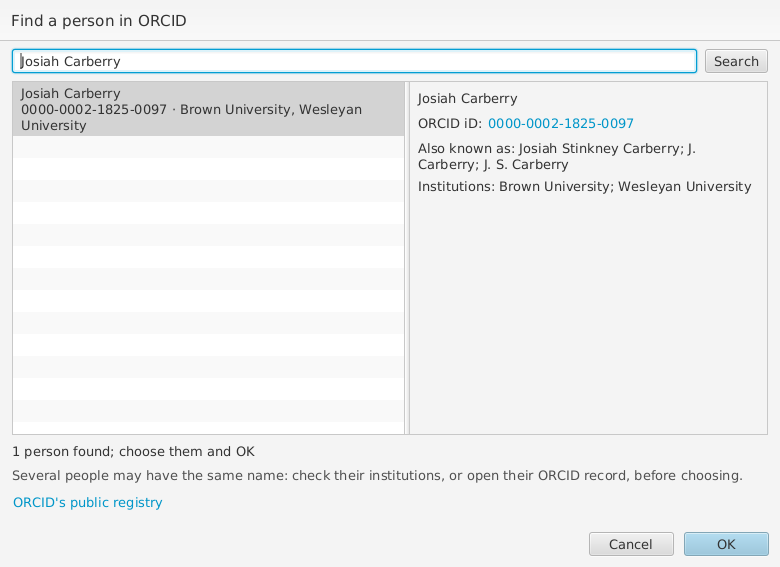
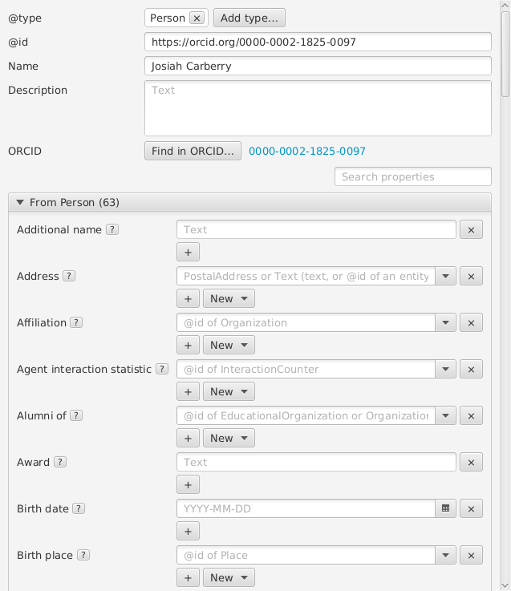
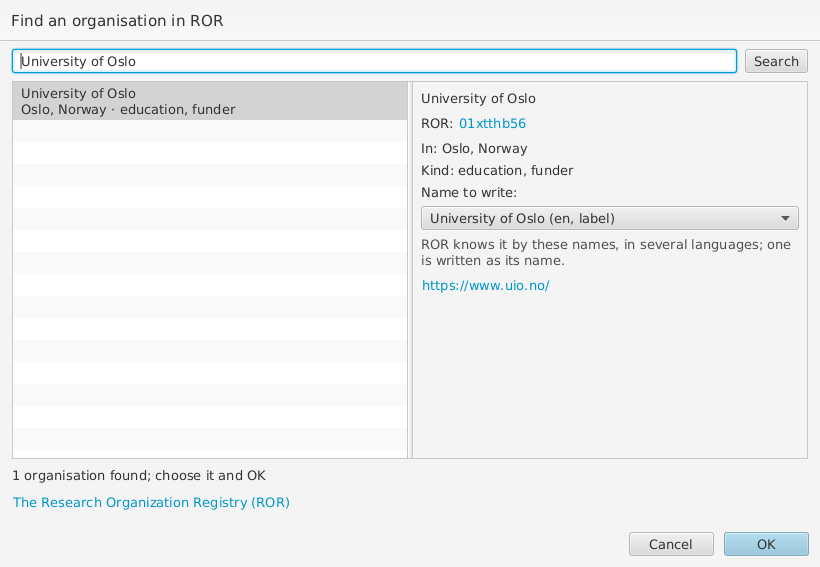
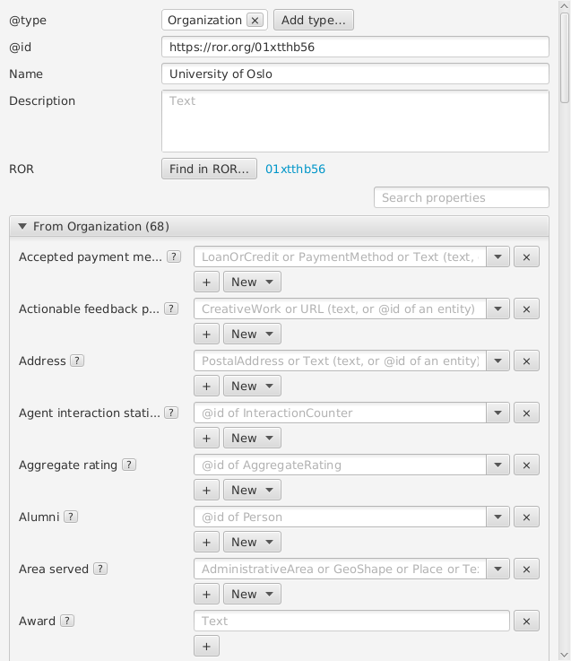
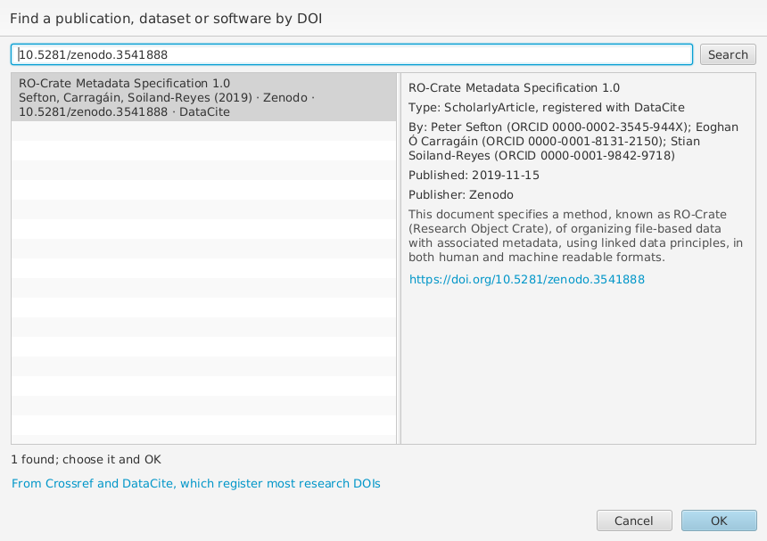
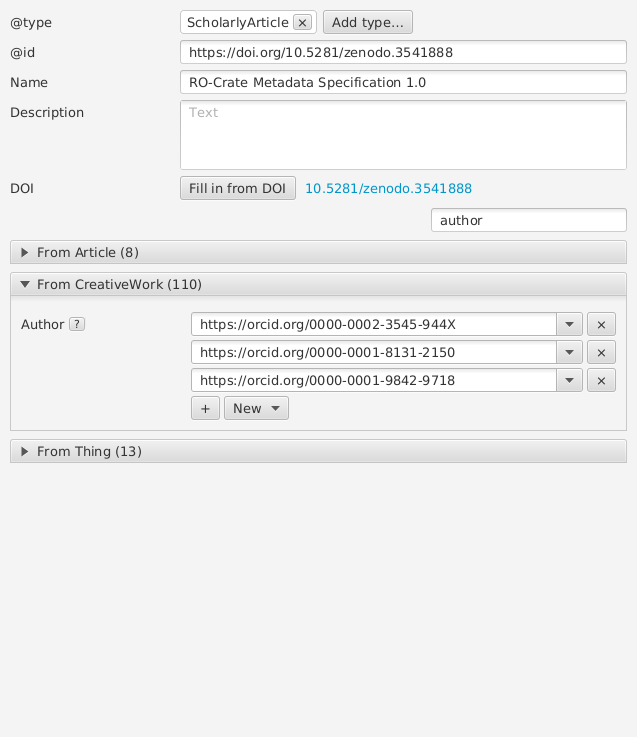
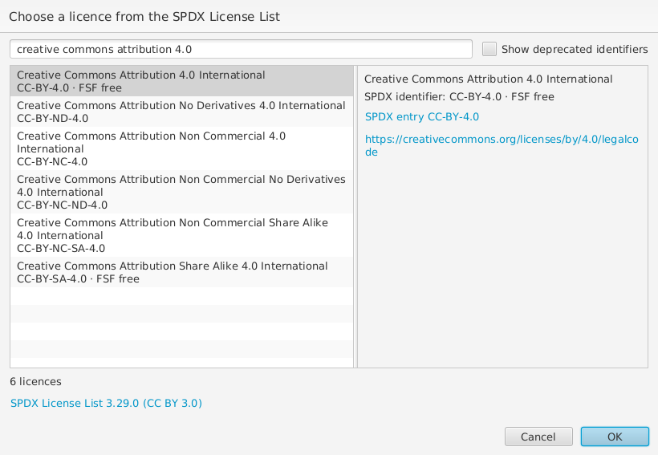
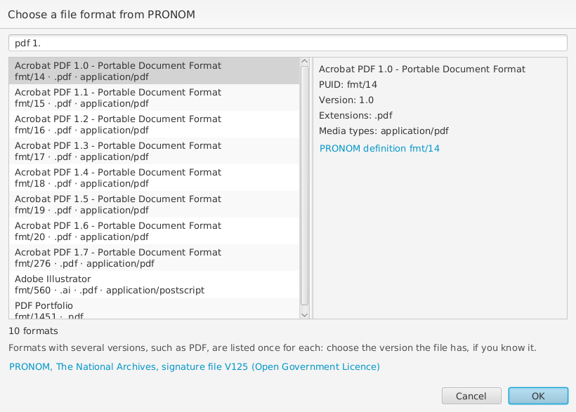
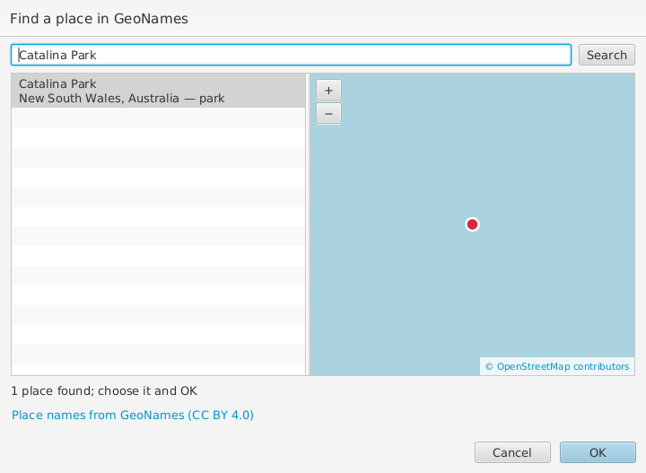
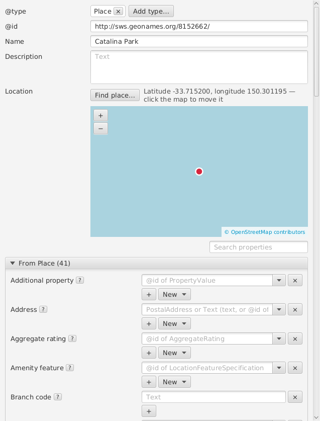

# Properties and links

Properties describe an entity: for example, Name is text and Author can
link a dataset to a person. Select an entity to see fields for its
[types](types.md). Required or suggested fields from the chosen profile
appear first. The **?** or information button beside a field shows its
definition.

In the list-style form, type a property name or label in **Search
properties** to find it; clear the search to see the other groups again.
In the OS/2 Warp notebook, browse the type tabs and their pages instead.
Enter a value in the field. Use **+** to add another value and **×** or
**−** to remove a value, where available.

## Link to an entity

For a reference field such as Author, open its drop-down and choose a
matching entity, or type its `@id`. The suggestions can be filtered by
name or identifier. You can also copy one entity from the list and paste
it into a reference field: its identifier is inserted as a link.

To create and link a new description, choose **New** beside the property
and select a type from its menu. Select the new entity in the list to fill
in its name and other details, then return to the original entity to
review the link. Creating a File description does not create the file.
If you remove a link, the linked description is not itself deleted.

Some properties also accept plain text, such as licence terms. Check that
the value is appropriate and that references point to the intended
entities.

## People

RO-Crate recommends identifying people by their
[ORCID iD](https://orcid.org/), such as
`https://orcid.org/0000-0002-1825-0097`. To add an author (or another
person) from ORCID, choose **New** beside **Author**, then **Person from
ORCID...**. Type their name, or their ORCID iD, and choose **Search**: the
people found are listed with their ORCID iD and institutions, and the one
selected with their other names, its ORCID iD a link to their record. Several
people may have the same name, so check before choosing. Choose one and
**OK**: wpsld adds them as a Person with their ORCID iD as `@id`, their
name, and their given and family names. If the crate already has them,
they are linked instead.

A Person's form shows their ORCID iD, if their `@id` is one, beside **Find
in ORCID...**, which looks up a person you have already added, by their
name, and gives them their ORCID iD as `@id`.

Looking people up needs an internet connection, but no account. Without
one, or if ORCID can't be reached, you can still type the ORCID iD as the
person's `@id`. **Edit > Repair Crate** writes ORCID iDs given in other
forms, such as `http://orcid.org/0000-0002-1825-0097/`, as
`https://orcid.org/0000-0002-1825-0097`, and merges people who turn out to
be the same; iDs whose check digit is wrong are left for you to correct.

## Organisations

RO-Crate recommends identifying organisations, such as a publisher, funder
or a person's affiliation, by their [ROR](https://ror.org/) identifier,
such as `https://ror.org/01xtthb56`. To add one from ROR, choose **New**
beside **Publisher** (or **Funder**, **Affiliation** and other fields that
take an organisation), then **Organization from ROR...**. Type its name,
or its ROR identifier, and choose **Search**: the organisations found are
listed with where they are and what kind they are.

An organisation often has many names, in several languages: ROR's display
name, and others such as its name in the local language, former names and
acronyms. Only one is written, as its `name`; choose it under **Name to
write**, e.g. *Universitetet i Oslo* rather than *University of Oslo*.
Choose **OK**: wpsld adds it as an Organization with its ROR identifier as
`@id`, the name chosen, its web site as `url`, and its city as `location`,
a Place from GeoNames (see [Places](#places)), shared with other
organisations in the same city. If the crate already has it, it is linked
instead.

An Organization's form shows its ROR identifier, if its `@id` is one,
beside **Find in ROR...**, which looks up an organisation you have already
added, by its name, and gives it its ROR identifier as `@id`.

Looking organisations up needs an internet connection, but no account;
ROR allows about 50 searches in 5 minutes. Without a connection, you can
still type the ROR identifier as the organisation's `@id`. **Edit > Repair
Crate** writes ROR identifiers given in other forms, such as
`http://ror.org/01xtthb56/`, as `https://ror.org/01xtthb56`, and merges
organisations that turn out to be the same; identifiers whose check digits
are wrong are left for you to correct.

## Publications and DOIs

A publication, dataset or software that the crate cites or is based on is
best identified by its DOI, written as `https://doi.org/10....`. Choose
**New** beside **Citation** (or **Is based on**, or **Subject of**), then
**Work by DOI...**. Type its DOI, in any of its usual forms (`10.5281/...`,
`doi:10.5281/...` or `https://doi.org/10.5281/...`), or words of its title
and authors, and choose **Search**: a DOI is looked up at the agency that
registered it, and words are searched in Crossref (which registers most
journal articles and books) and DataCite (most datasets and software, for
example those in Zenodo).

Choose one and **OK**: wpsld adds it with its DOI as `@id` and
**Identifier**, its type (such as ScholarlyArticle or Dataset), title as
**Name**, **Date published**, **Abstract** where the agency has one, a short
citation such as "Xuan et al. (2015): Topic Model for Graph Mining. IEEE
Transactions on Cybernetics" in
**Credit text**, its first authors as Persons (by
their ORCID iD where the agency knows it, or a person the crate already
has by the same name), and the journal it is in, by its ISSN. If the crate
already has the work, it is linked instead.

You can also type or paste a DOI straight into **Citation** (in any of
those forms) and press Enter or leave the field: it becomes a link to
`https://doi.org/...`, as RO-Crate asks of citations, and if the crate
doesn't describe the work yet, wpsld looks it up for you to add with
**OK**; **Cancel** keeps just the link.

A work whose `@id` is a DOI has a **DOI** row with **Fill in from DOI**,
which adds what is missing, keeping what it has; an article, book, chapter,
report or thesis without a DOI has **Find DOI...**, which looks it up by
its name. Looking up needs an internet connection; without one, you can
still type the DOI as `https://doi.org/...` by hand. **Edit > Repair
Crate** writes DOIs given in other forms (`http://dx.doi.org/...`,
`doi:...`) as `https://doi.org/...`, merges works whose DOIs differ only
in case, and turns a **Citation** given as text that is a DOI into a link.

## Licences

RO-Crate asks for a **License** on the crate itself (the root dataset), and
on any file whose licence differs from the crate's. wpsld includes the
[SPDX License List](https://spdx.org/licenses/), which names the common
licences and gives each a short identifier, such as `CC-BY-4.0` or
`Apache-2.0`.

To add one, choose **New** beside **License**, then **Licence from
SPDX...**. Type part of the licence's identifier or name, for example
`cc-by-4.0`, `apache` or `creative commons attribution 4.0`: the list
narrows while you type, with whether a licence is OSI approved or FSF free.
The licence selected is described beside the list, with links to its
SPDX entry and to the licence itself. Choose one and
**OK**.

wpsld then adds the licence as RO-Crate recommends: a CreativeWork whose
`@id` is its SPDX address, such as `http://spdx.org/licenses/CC-BY-4.0`,
named as SPDX names it, with its SPDX identifier (`CC-BY-4.0`) as a
PropertyValue in its **Identifier**. If the crate already has that licence,
for example to give a file the same licence as the crate, it is linked
rather than added again.

SPDX has replaced some identifiers, for example `GPL-2.0` by `GPL-2.0-only`
and `GPL-2.0-or-later`. Those are hidden unless you tick **Show deprecated
identifiers**, e.g. to match what a crate already says.

Crates made elsewhere may give a licence in other ways, for example as
the text `CC-BY-4.0`, with an address copied from the browser such as
`https://spdx.org/licenses/Apache-2.0.html`, or with the licence's own web
page, such as `https://creativecommons.org/licenses/by/4.0/`. **Edit >
Repair Crate** turns these into links to the SPDX licence, merges licences
that turn out to be the same, and adds the SPDX name and identifier where
they are missing, keeping any name the licence already has; a licence's
own web page is kept as its **URL**. Some pages can't tell which licence
is meant, such as GNU's GPL page, which serves both "GPL-3.0-only" and
"GPL-3.0-or-later": those are left for you to choose.

For a licence that isn't on the SPDX list, choose **New > CreativeWork**
instead, set its `@id` to the licence's own web address, and give it a
**Name** and a **Description** summarising it.

## File formats

RO-Crate asks files for their **Encoding format**: the media type, such
as `text/csv` or `application/pdf`, and, where it can, a link to the
format's description in [PRONOM](https://pronom.nationalarchives.gov.uk/),
the UK National Archives' registry of file formats. wpsld includes PRONOM's
list of formats, so this works offline.

On a file, choose **New** beside **Encoding format**, then **Format from
PRONOM...**. The search starts with the file's media type, or the
extension of its name (for example `.csv`); you can also type a name, a
version or a PRONOM identifier (PUID) such as `fmt/19`. Choose the format
and **OK**: wpsld links the format, described as a WebPage and Standard
with its PRONOM address as `@id`, and adds its media type if the file has
none.

Many formats have several versions, and PRONOM lists each: PDF 1.4, 1.5,
1.7 and PDF/A all have the media type `application/pdf` and the extension
`.pdf`. Choose the version the file has, if you know it, or leave just the
media type.

**Edit > Repair Crate** links the PRONOM format where a file's media type
belongs to only one format, such as `text/csv` or `text/markdown`, but not
`application/pdf`. It also turns PRONOM addresses copied from its web site,
such as `https://pronom.nationalarchives.gov.uk/fmt/19`, into the form
RO-Crate uses, `https://www.nationalarchives.gov.uk/PRONOM/fmt/19`.

## Places

To say where something is, or which area it covers, link it to a
**Place** with **Content location** (where it was made or what it shows)
or **Spatial coverage** (the area it is about).

The easiest way is **New** beside the property, then **Place from
GeoNames...**. Type the name of the place and choose **Search**; the
matches are listed with their region, country and kind (park, city,
mountain...), and the one selected is shown on a map. Choose one and
**OK**: wpsld adds the place with its GeoNames identifier, which RO-Crate
recommends, its name and web page, and where GeoNames has it. If the crate
already has that place, it is linked instead of added again.

Looking places up needs a free GeoNames account: make one at
[geonames.org](https://www.geonames.org/login), enable its free web
services on your account page, and enter your username in **Edit >
Preferences > Places**.

A place's form shows it on a map under **Location**. Drag the map to move
it, and scroll or use **+** and **−** to zoom. Click the map to put the
place where you clicked, for example a more exact spot than GeoNames has,
or a place GeoNames doesn't know. **Find place...** looks up a place you
have already added, by its name. The map is from OpenStreetMap, so it
needs an internet connection.

Behind the scenes, the location is a **Geometry** linked from the place's
**Geo**, with the point as Well-Known Text in **As WKT**, for example
`POINT (150.301195 -33.7152)` (longitude first). You can edit that
directly, e.g. for a line or an area. Places in older crates with
GeoCoordinates, Latitude and Longitude are shown and moved too.
