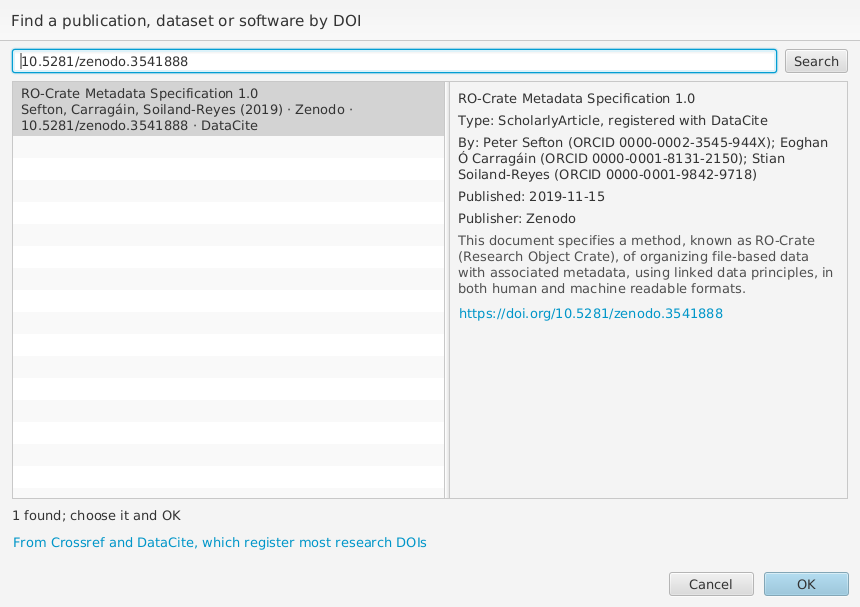
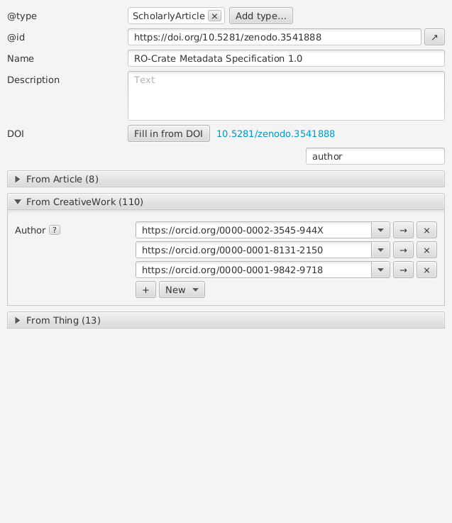

# Publications and DOIs

A publication, dataset or software that the crate cites or is based on is
best identified by its DOI, written as `https://doi.org/10....`. Choose
**New** beside **Citation** (or **Is based on**, or **Subject of**), then
**Work by DOI...**. Type its DOI, in any of its usual forms (`10.5281/...`,
`doi:10.5281/...` or `https://doi.org/10.5281/...`), or words of its title
and authors, and choose **Search**: a DOI is looked up at the agency that
registered it, and words are searched in Crossref (which registers most
journal articles and books) and DataCite (most datasets and software, for
example those in Zenodo).

Choose one and **OK**: wpsld adds it with its DOI as `@id` and
**Identifier**, its type (such as ScholarlyArticle or Dataset), title as
**Name**, **Date published**, **Abstract** where the agency has one, a short
citation such as "Xuan et al. (2015): Topic Model for Graph Mining. IEEE
Transactions on Cybernetics" in
**Credit text**, its first authors as Persons (by
their ORCID iD where the agency knows it, or a person the crate already
has by the same name), and the journal it is in, by its ISSN. If the crate
already has the work, it is linked instead.

You can also type or paste a DOI straight into **Citation** (in any of
those forms) and press Enter or leave the field: it becomes a link to
`https://doi.org/...`, as RO-Crate asks of citations, and if the crate
doesn't describe the work yet, wpsld looks it up for you to add with
**OK**; **Cancel** keeps just the link.

A work whose `@id` is a DOI has a **DOI** row with **Fill in from DOI**,
which adds what is missing, keeping what it has; an article, book, chapter,
report or thesis without a DOI has **Find DOI...**, which looks it up by
its name. Looking up needs an internet connection; without one, you can
still type the DOI as `https://doi.org/...` by hand. **Crate > Repair
Crate** writes DOIs given in other forms (`http://dx.doi.org/...`,
`doi:...`) as `https://doi.org/...`, merges works whose DOIs differ only
in case, and turns a **Citation** given as text that is a DOI into a link.
