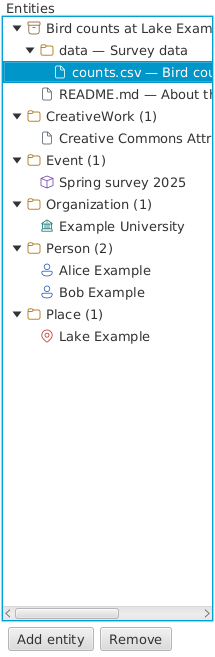

# Views and styles

Select an entity on the left to edit its form in the middle. On the right,
**Preview** shows the selected entity and its links; **JSON-LD** shows the
crate's metadata. Selecting a link to another described entity in Preview
opens it in the editor.

The entity list shows the dataset as a whole (the root) first, then the
other entities by type, name and `@id`. An entity moves to its place in
the list when you leave the field you are typing its name in. To see only
entities of one type, choose it above the list: CreativeWork, for example,
also shows Datasets and Files. Adding an entity of another type lists all
types again.

Choose **View > Entities by Folder** to see them as a tree instead, as a
file manager shows files:

- First the dataset as a whole, with its folders and files by their
  `@id`s, e.g. `data/counts.csv` in the folder `data`. A folder is shown
  even if no Dataset describes it. Greyed out are such folders, and files
  that are not part of the crate (not in its or its folders' **Has
  part**), e.g. only cited.
- Then **External resources**: parts of the crate on the web, by their
  addresses.
- Then a folder for each type of the other entities, e.g. **Person**. An
  entity of several types, e.g. Organization and Place, is in the folder
  of each. A part of a file, with an `@id` such as `report.html#table2`,
  is in the folder of its type, and under the file, if the crate
  describes it.

**View > Entities by Part** shows another tree: what the crate is made
of, by **Has part**. The dataset as a whole holds its parts, and each
Dataset its own parts, wherever their files are: a part of two datasets
is under both. Parts are named by their path from their dataset's
folder. The other entities follow in a folder for each type, as by folder.

To bring a greyed out folder or file into the crate, select it (or
several) and choose **Crate > Add Dataset for Folder** or **Add to Has
Part**, also on the right-click menu. A folder gets a Dataset, and a file
becomes a part, of the Dataset of the folder above it, or of the crate
itself if that folder has none; select the outer folders too to add them
all at once. Add to Has Part also makes a File or Dataset on the web a
part of the crate, under **External resources**.

Selecting an entity selects it in each place it is shown; **Copy** and
**Remove** act on it once. Each entity has an icon for its type. **View > Entities by Type** shows the
list again.

Use **View > Sidebar** to hide or show the entity list. On macOS the menu
item says **Hide Sidebar** or **Show Sidebar**.

Choose **View > Style** to change the appearance and form layout, and
**View > Colours** for light, dark or system colours. OS/2 Warp presents
the form as a notebook with type tabs and pages; other styles use
expandable groups and property search. Changing the view does not change
the metadata.

**Help > About wpsld...** shows the application and runtime versions,
licences and third-party notices.
